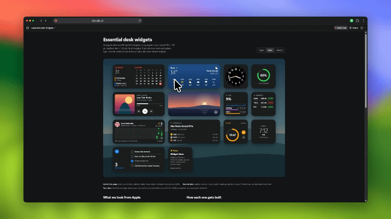

# Desk Widgets

Lightweight desktop widgets for Windows. Native C# on the .NET Framework 4 that ships with every
Windows 10/11 PC, so there is nothing to install. All widgets run in one process: about 33 MB of
memory and about 0.3% of one CPU core with seven widgets on the desktop.

**[Website](https://whoissaaif.github.io/desk-widgets/)** ·
**[Download](https://github.com/whoissaaif/desk-widgets/releases/latest/download/DeskWidgets.exe)** ·
**[Community widgets](https://whoissaaif.github.io/desk-widgets/explore.html)** ·
[Contributing](CONTRIBUTING.md) · [Security](SECURITY.md)

<p align="center">
  
</p>

## Install

Download `DeskWidgets.exe` from the [latest release](https://github.com/whoissaaif/desk-widgets/releases/latest)
and run it — it's a single file, no installer needed. It adds itself to the Start menu and
registers the `deskwidgets://` protocol for one-click installs from the website.

An **installer** (`DeskWidgets-Setup.exe`) is also available in the release. It does the same
setup with a wizard and adds an uninstaller to Settings › Apps.

Windows SmartScreen may warn about an unsigned app the first time; choose More info › Run anyway,
or build it yourself from source (below).

The app checks for updates automatically and shows a dialog when a new version is available.

## Build & run (any Windows PC)

```
git clone <this repo>
cd <repo>
build.bat
bin\DeskWidgets.exe
```

The first run adds **Desk Widgets** to the Start menu (it's recreated if missing, or if the exe it
pointed to was moved), so after that you can just search for it.

`build.bat` first runs `tools\check-hidden.ps1`, which refuses characters that can make code read
differently from how it runs (lone CR, U+2028, bidi and zero-width characters). To run the same
check before every commit, turn on the repo's hooks once per clone:

```
git config core.hooksPath .githooks
```

## Widgets

The app ships with three built-in clock faces. Everything else — calendar, weather, system monitor,
and more — is published through the **community gallery** and installed from Explore. This keeps the
app small and lets widgets update independently.

### Built-in

| Widget | Size | Notes |
| --- | --- | --- |
| Analog Clock | Small | Local time, classic dial |
| Analog Clock · Dark | Small | Local time, dark dial |
| World Clock | Small | Any city (starts on Paris) |

### Community (shipped by the owner, installed from Explore)

| Category | Widget | Size | Notes |
| --- | --- | --- | --- |
| Productivity | Calendar | Medium | Today, next events, the month; events from calendar subscription links (.ics) |
| Weather | Weather | Medium | Open-Meteo (free, no account); type a city once; °C or °F; refreshes every 15 min |
| Productivity | Focus Timer | Small | Start/pause/reset; keeps running across restarts |
| Productivity | Reminders | Medium | Click a circle to tick off, click elsewhere to add; can also list today's Calendar events |
| Productivity | Notes | Small | Click and type straight on it; first line is the title; click away or Esc to save |
| System | System | Small | CPU (1 min history), memory, disk; reads Windows directly every 2 s |
| Media | Photo Frame | Medium | Just the picture (no file name); animated GIFs play; changes hourly or on hover › next |
| Media | Now Playing | Medium | Whatever Windows is playing (Spotify, browsers, Media Player): art, progress, play/pause/skip |
| Developer | GitHub | Medium | Profile, streak, 30 weeks of contributions; refreshes every 30 min |
| Sports | F1 Hub | Medium | Next race, schedule, standings from the Jolpica F1 API |
| Sports | F1 Live Timing | Large | Session timing, gaps, track map from OpenF1 |

Users upgrading from an older version that had these as built-in are prompted to download them from
Explore; their settings are migrated automatically.

Card widgets follow Apple's widget specs (small 170 × 170 pt, medium 364 × 170 pt, large
364 × 382 pt, 16 pt margins, 22 pt corners) with **Dark**, **Light** and **Vibrant** appearances.
Vibrant shows your wallpaper blurred behind the widget with white content, like macOS desktop
widgets; it is sampled from a tiny cached copy of the wallpaper, so it costs nothing while idle (it
re-samples when you move the widget or change the wallpaper). The analog clocks have a Vibrant face
too. The design language is `design/apple-design.md` (section 17 covers this app);
`design/essential-widgets.html` is a mockup of the widgets.

**Calendar events:** right-click › Add a calendar, and paste the calendar's private iCal link
(Google: "Secret address in iCal format"; Outlook: Publish calendar; iCloud: public link). Links and
the cached events are stored encrypted with DPAPI. Repeating events (daily, weekly on chosen days,
monthly, yearly) and time zones are handled; unusual repeat rules may be missed.

**Weather:** click the widget and type a city. Its name is looked up once; after that only the
coordinates are sent to Open-Meteo.

**GitHub sign-in:** click the widget and either paste a personal access token (stored encrypted
with Windows DPAPI for your account only) or choose "Use my GitHub CLI login" if `gh` is installed.
Nothing is read until you choose. The last result is cached in `%APPDATA%\DeskWidgets\cache`, so the
widget shows instantly at startup and keeps working offline.

## Using it

- **The app window**: open it from the Start menu, the tray icon, or by launching the exe again.
  Widgets are grouped by category in the sidebar; Installed lists the widgets you added.
  **Drag** a widget out onto the desktop, or **double-click** it to drop it mid-screen. Closing the
  window frees its memory; widgets and the tray icon keep running.
- **On the desktop**: drag a widget to move it; click its buttons to use it. Right-click it for its
  options. Menus, dialogs and the window are drawn in Apple's style and follow the Windows light/dark
  setting.
- **Tray menu**: Open Desk Widgets, Start with Windows, High Priority, Quit Desk Widgets.
- **Start with Windows** launches with `--background`: widgets come back, no window opens. The app
  only changes this entry when you toggle it.
- **High Priority** uses Task Scheduler (Above Normal priority) instead of the registry Run key,
  so widgets start earlier and render more smoothly alongside heavy apps.
- **Auto-update**: the app checks GitHub releases in the background and shows a dialog when a new
  version is available, with release notes and a download link.
- **Community widgets**: Explore (in the window and on the website) lists community widgets, each
  read and approved by the owner before it appears. **Get** opens Desk Widgets, which downloads
  that exact version, checks its hash and asks before installing. Clicking Get on the website uses
  the `deskwidgets://install/` protocol to hand the install to the running app. Explore marks the
  ones you have as Installed. The Installed section shows them with **Update** when a newer approved
  version is out, and **Install from File…** for a `.cs` you wrote yourself (see
  `samples/HelloWidget.cs`). Setup of the backend and website: `server/README.md`; the design:
  `design/community-plan.md`.
- **Uploading your own**: uploading is by invitation. Request access with your email on the
  [Upload page](https://whoissaaif.github.io/desk-widgets/upload.html); when the owner accepts,
  you get an email to choose a username, password, bio and photo. Then sign in on the website or in
  the app (the account row at the bottom of the sidebar) and upload from either: Explore ›
  Upload a Widget…, or right-click a widget you installed from a file › Upload to the Gallery…
  (it sends a preview rendered from the widget). The app keeps only a refresh token, encrypted with
  DPAPI in `%APPDATA%\DeskWidgets\account.dat`.

## Settings & portability

- Settings live in `%APPDATA%\DeskWidgets\widgets.ini` (one `[section]` per widget).
- **Portable mode**: if a `widgets.ini` exists next to `DeskWidgets.exe`, that file (and a `cache`
  folder beside it) is used instead (handy on a USB stick).
- Positions are stored relative to the monitor (`fx`/`fy`, 0..1). A widget in a corner stays in that
  corner on any resolution, DPI, or machine, and re-snaps when the display changes.
- Sizes are in logical pixels and scale with DPI.

## Why it's light

- Per-pixel-alpha layered window (`UpdateLayeredWindow`) drawing into one reusable DIB, with no per-frame allocations.
- Widgets redraw only when something changes: the clock once a second, System every 2 s, the timer
  only while running, the rest on demand. Drawing pauses while the PC is locked.
- Slow work (network requests, decoding photos) runs on background threads; photos are kept only as a
  widget-sized bitmap.

## Adding a new widget

Most widgets belong in the community gallery, not compiled into the app. Write one C# file (start
from `samples/HelloWidget.cs`), test it with Installed › Install from File…, then upload it to the
gallery. See [CONTRIBUTING.md](CONTRIBUTING.md) for details.

To add a **built-in** widget:

1. Create `src/Widgets/MyWidget.cs`. For an Apple-style card, derive from `CardWidget`
   (`base(settings, medium)`) and implement `DrawContent(g, pal)`, laying out in points with `P()`.
   For anything else derive from `WidgetWindow` and implement `Measure()` and `Draw()`.
   Optional overrides:
   - `NextFrameDelay()`: ms until the next redraw, or `-1` for on-demand only
   - `IsButton(p)` / `OnWidgetClick(p)`: clickable areas (a press that doesn't move is a click)
   - `BuildWidgetMenu(menu)` (cards) or `BuildMenu(menu)`: right-click options, stored with `Settings.Set(...)`
   - `OnStart()`: start timers or fetches (not called for library previews)
2. Register it in `src/WidgetRegistry.cs` with a `Category` (add a new `WidgetCategory` with a
   Segoe Fluent Icons glyph if needed), name, description and optional preset `Defaults`.
   It shows up in the app under its category automatically.
3. Run `build.bat`.

The app icon is `assets/app.ico`, generated by `tools/MakeIcon.cs`.

Code must stay C# 5 (the compiler built into Windows): no `$"..."`, `?.`, or `=>` members.

## Project layout

| Path | What |
| --- | --- |
| `src/` | The app (one exe, C# 5, no dependencies) |
| `docs/` | The website (landing page, explore, profiles, upload, admin), served by GitHub Pages from `main` |
| `server/` | Supabase schema, Edge Functions (`invite`, `login`), email templates, and tests |
| `design/` | The design language (`apple-design.md`), the community design and widget mockups |
| `packaging/` | Inno Setup installer script and MSIX manifest for Windows packaging |
| `samples/` | A minimal community widget (`HelloWidget.cs`) |
| `tools/` | Icon generator, hidden-character check, and carousel validation |

## Contributing

Issues and pull requests are welcome; see [CONTRIBUTING.md](CONTRIBUTING.md). Report security
problems privately as described in [SECURITY.md](SECURITY.md).

## License

[MIT](LICENSE).
